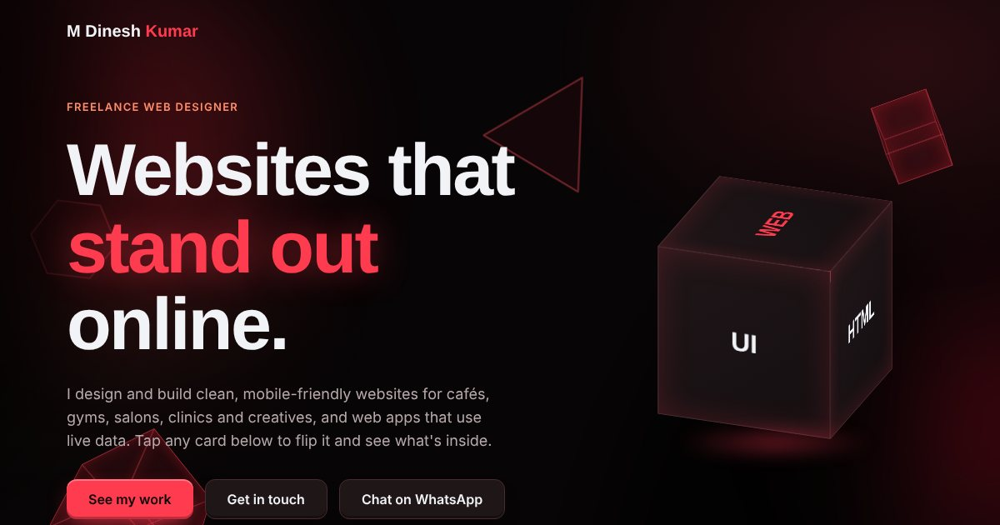

# Dinesh Kumar | Web Developer Portfolio

**Live site:** https://dineshmkumar159-wq.github.io/Portfolio/

A portfolio of 17 websites and web apps for small businesses: hospitals, schools, restaurants, salons, resorts and more. Four of them are **full-stack** apps with online booking, admin dashboards and installable (PWA) versions. The rest are responsive concept sites, each with its own design.

I am an Electronics and Communication Engineering graduate (2026) from Chennai, open to **full-time remote roles** and **freelance web projects**.

## Full-stack projects

Each runs as an online demo in the browser (data is stored in the visitor's browser). The real version uses a Node.js server with a SQLite database.

| Project | What it shows | Live demo |
| --- | --- | --- |
| **Aurelia Care Hospital** | Appointment booking that blocks double-booked slots, doctor and package pages, staff panel, **Ask Aurelia** chat assistant, and a **WhatsApp bot** demo with Node.js webhook code | [Open](https://dineshmkumar159-wq.github.io/Portfolio/aurelia-care/) · [WhatsApp demo](https://dineshmkumar159-wq.github.io/Portfolio/aurelia-care/whatsapp.html) |
| **Meridian Public School** | 12 pages for 5 campuses, 3D campus map, fee calculator, admission enquiries, admin dashboard | [Open](https://dineshmkumar159-wq.github.io/Portfolio/meridian-school/) |
| **Spice Lane Food Court** | Three installable apps (customer, kitchen, owner) sharing one set of business rules | [Open](https://dineshmkumar159-wq.github.io/Portfolio/spice-lane/) |
| **Mirror Hour Salon & Studio** | Salon booking with a shared booking module, so a stylist can never be double-booked | [Open](https://dineshmkumar159-wq.github.io/Portfolio/mirror-hour/) |

## Live apps

- [Guest house website](https://kumar-hospitality.lovable.app)
- [AnimeVerse, anime discovery app](https://anime-airing-atlas.lovable.app)

## Concept sites

[Dabara Kaapi](https://dineshmkumar159-wq.github.io/Portfolio/dabara-kaapi/) (cafe) · [Chalk Room](https://dineshmkumar159-wq.github.io/Portfolio/chalk-room/) (gym) · [Studio Halide](https://dineshmkumar159-wq.github.io/Portfolio/studio-halide/) (photography) · [Rootline Dental](https://dineshmkumar159-wq.github.io/Portfolio/rootline-dental/) (clinic) · [Saltwind Resort & Spa](https://dineshmkumar159-wq.github.io/Portfolio/saltwind-resort/) · [Zari Lane](https://dineshmkumar159-wq.github.io/Portfolio/zari-lane/) (retail) · [Plinth Homes](https://dineshmkumar159-wq.github.io/Portfolio/plinth-homes/) (real estate) · [Inkwell Academy](https://dineshmkumar159-wq.github.io/Portfolio/inkwell-academy/) (education) · [Halo & Hush](https://dineshmkumar159-wq.github.io/Portfolio/halo-hush/) (fragrance) · [Brewline Coffee Roasters](https://dineshmkumar159-wq.github.io/Portfolio/brewline/)

All businesses, names, prices and numbers in these projects are samples.

## Built with

HTML, CSS and JavaScript · Node.js and SQLite (real versions) · Progressive Web Apps · GitHub Pages · AI-assisted development (Claude, Lovable)

## Performance

The portfolio page was tuned to stay smooth on slower computers: no heavy blur effects, a capped background animation, and animations that pause when off screen.

## Contact

- Email: dineshmkumar159@gmail.com
- Phone and WhatsApp: 7200116285
- Resume: [Dinesh_Kumar_Resume.pdf](https://dineshmkumar159-wq.github.io/Portfolio/Dinesh_Kumar_Resume.pdf)
